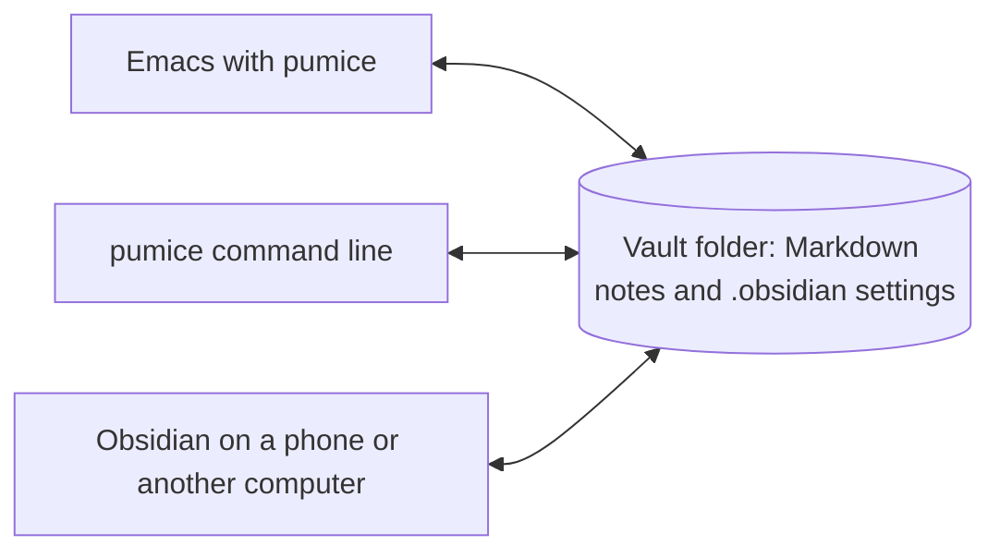

# pumice

Pumice lets you work in an Obsidian vault from Emacs, without Obsidian
running. It is for people who keep their notes in a vault, already live in
Emacs, and would rather not run a second, heavier app to read them.


The recording has the optional packages installed (vertico, consult, corfu
and markdown-mode) and uses the Atom One Dark theme. Pumice needs none of
them.

Pumice is the same volcanic glass as obsidian with most of the weight taken
out, which is where the name comes from.

Your notes stay where they are and stay plain Markdown with `[[wikilinks]]`.
Pumice reads each vault's `.obsidian` settings to learn where daily notes,
templates and new notes go, and it puts nothing of its own in the vault. So
Obsidian on your phone, or on another computer, keeps working on the same
files.



## What it does

- Jump to a note by name or alias. A name that matches nothing starts a new
  note in the folder the vault uses for new notes.
- Follow `[[Note]]`, `[[Note#Heading]]`, `[[Note|shown text]]`, `![[embeds]]`
  and Markdown links to notes. Links are coloured by whether they resolve,
  and they resolve the way Obsidian resolves them, including when two notes
  share a name.
- Complete note names after `[[`, headings after `[[Note#`, and tags after
  `#`.
- A backlinks panel that follows the note you are in. It lists the lines
  that link to the note, the lines that mention it without linking, and the
  note's own outgoing links.
- A folder tree in a side window.
- Daily notes in the vault's own folder, date format and template, with
  commands for yesterday, tomorrow, any date, and the next or previous daily
  note that exists.
- Templates, with Obsidian's `{{title}}`, `{{date}}` and `{{time}}`
  variables.
- Rename or move a note and have every link to it rewritten. Extract a
  region into a note of its own. Move a note to the vault's `.trash`.
- Tags, nested ones included, read from the text and from frontmatter.
- Search the text of every note.
- A command line, `pumice`, that answers the same questions for scripts and
  coding agents without a running Emacs.

It does not render embeds or Markdown inline, draw a graph, run Obsidian
plugins, or sync anything. Dataview queries, canvases and `.base` files show
up as files you can link to, not as what Obsidian would draw. Frontmatter is
read as the flat properties Obsidian writes, not as arbitrary YAML.

## Install

Pumice needs Emacs 29.1 or later and nothing else.

On Emacs 30 or later:

```elisp
(use-package pumice
  :vc (:url "https://github.com/kirahowe/pumice")
  :defer t
  :init
  (pumice-global-mode 1)
  (keymap-global-set "C-c n" 'pumice-command-map))
```

That installs the latest release. To follow the main branch instead, add
`:rev :newest` after the URL.

On Emacs 29, run `M-x package-vc-install`, give it
`https://github.com/kirahowe/pumice`, and put the two lines from `:init` in
your init file.

Without a package manager, clone the repository, add the directory to
`load-path`, and `(require 'pumice)` before those two lines.

`pumice-global-mode` turns on `pumice-mode` in every Markdown file that lives
in a vault. `pumice-command-map` holds the commands. Nothing binds it for
you, so `C-c n` above is only a suggestion.

## Finding your vaults

If Obsidian has been run on this computer, pumice reads its list of vaults
and there is nothing to configure. The vault Obsidian had open last is the
default one, used when the current buffer is not in a vault.

If Obsidian was never installed here, say where the vaults are:

```elisp
(setq pumice-vault-directories '("~/Notes" "~/Work notes"))
```

A folder does not need a `.obsidian` directory to be listed there, so a
plain folder of Markdown files works too. It gets the defaults: daily notes
named `YYYY-MM-DD` at the top of the folder, and no templates.

## Keys

In a note:

| Key | What it does |
| --- | --- |
| `C-c C-o` | Follow the link at point. Away from a note link, the key does whatever the major mode has it do |
| `mouse-1` | Follow the link clicked on |
| `M-,` | Go back to where you were before following a link or jumping to a note |

Under the prefix you chose for `pumice-command-map`:

| Key | What it does |
| --- | --- |
| `n` or `f` | Jump to a note, or start one |
| `s` or `/` | Search the text of every note |
| `#` | Pick a tag, then a note that has it |
| `h` | Open the home note (`pumice-home-note`, "Home" by default) |
| `z` | Open a note at random |
| `v` | Switch to another vault |
| `d` `y` `t` | Daily note for today, yesterday, tomorrow |
| `D` | Daily note for a date picked from the calendar |
| `<` `>` | The previous or next daily note that exists |
| `a` | Add a timestamped line to today's log without leaving the buffer |
| `c` | Start a new note |
| `i` | Insert a link to a note. An active region becomes the link's text |
| `T` | Insert a template |
| `x` | Extract the region into a new note and leave a link behind |
| `r` | Rename or move the note, rewriting links to it |
| `X` | Move the note to the vault's trash |
| `RET` | Follow the link at point, or tick the checkbox on this line |
| `[` `]` | Move to the previous or next link |
| `e` | Show the folder tree, or hide it from inside |
| `b` `B` | Show or hide the backlinks panel, or move to it |
| `O` | Open the note in Obsidian |

In the backlinks panel, `RET` goes to the line, `o` shows it without leaving
the panel, `l` turns an unlinked mention into a link, `n` and `p` move, `g`
redraws and `q` hides the panel.

In the folder tree, `RET` opens a note or folds a folder, `o` shows a note
without leaving the tree, the right and left arrows step into and out of
folders, `E` and `C` unfold and fold everything, `s` switches between
sorting by name and by date, `a` starts a note in the folder, `r` renames,
`g` rereads the disk and `q` hides the tree.

## Optional packages

Pumice uses these when they are installed and does without them otherwise.

| Package | What it adds |
| --- | --- |
| [consult](https://github.com/minad/consult) | A live preview of each note while you pick one, and a search that runs as you type. Without it you get plain `completing-read` and `rgrep` |
| [corfu](https://github.com/minad/corfu) or [company](https://company-mode.github.io) | A popup of note names as soon as you type `[[`. Without one, `M-x completion-at-point` completes them |
| [markdown-mode](https://jblevins.org/projects/markdown-mode/) | A major mode for the notes themselves. Its `gfm-mode` is the closer match for Obsidian's Markdown |
| [ripgrep](https://github.com/BurntSushi/ripgrep) | Unlinked mentions in the backlinks panel, and consult's search |

Pumice leaves the look of a note to you. Obsidian wraps long lines, and if
you want that:

```elisp
(add-hook 'pumice-mode-hook #'visual-line-mode)
```

## Keeping Emacs's own files out of the vault

By default Emacs writes backups (`Note.md~`), auto-saves (`#Note.md#`) and
lock files (`.#Note.md`) beside the file being edited. In a vault those get
synced to your other devices. Pumice ignores them when it indexes, but it
does not change where Emacs puts them. These lines send them elsewhere:

```elisp
(let ((backups (locate-user-emacs-file "backups/"))
      (auto-saves (locate-user-emacs-file "auto-saves/")))
  (make-directory auto-saves t)
  (setq backup-directory-alist `(("." . ,backups))
        auto-save-file-name-transforms `((".*" ,auto-saves t))
        create-lockfiles nil))
```

If something else edits the vault while Emacs is open, such as Obsidian on a
phone through a sync service, `(global-auto-revert-mode 1)` makes open notes
follow the files.

## Vim keys

Pumice has no opinion about evil. If you use it, one line adds the bindings:

```elisp
(require 'pumice-evil)
```

In a note, in normal state, `RET` follows the link or ticks the checkbox at
point, `gf` follows a link, `gF` and `S-RET` follow it in another window,
`]l` and `[l` move between links, and `]d` and `[d` move between daily
notes. The panel and the tree open in motion state. In the tree `h` and `l`
step out of and into folders, and `za`, `zM` and `zR` fold.

No leader key is bound. Put the command map on yours:

```elisp
(evil-define-key 'normal 'global (kbd "<leader>n") 'pumice-command-map)
```

## Spacemacs

`contrib/spacemacs/pumice` is a layer. Copy or symlink it to
`~/.emacs.d/private/pumice` and add `pumice` to
`dotspacemacs-configuration-layers`. It installs the package, turns the
global mode on, loads the vim keys unless your editing style is `emacs`,
and puts the commands under `SPC a N`. To move them:

```elisp
(pumice :variables pumice-leader-key "on")
```

## The command line

`bin/pumice` runs the same index in a batch Emacs. Nothing has to be
running, Obsidian included. Link it somewhere on your `PATH`:

```sh
ln -s /path/to/pumice/bin/pumice ~/.local/bin/pumice
```

After `package-vc-install` the script is in the `pumice` directory under
your `package-user-dir`.

```sh
pumice list --tag project --where status=active --show next_action
pumice backlinks "Weekly Review"
pumice tasks --folder Projects
pumice daily                        # path of today's note, created if missing
pumice log "Sent the invoice"       # a timestamped line under today's Log heading
pumice new "Title" --template "Meeting" --stdin < body.md
pumice set "Some note" status=done
pumice rename "Old name" "New name" # rewrites every link to the note
pumice unresolved                   # links that lead nowhere
```

`pumice help` lists every command. Lists print paths from the vault root, one
per line, or JSON with `--json`. The vault is the one named by `--vault` or
`$PUMICE_VAULT`, else the one holding the current directory, else the
default. If `emacs` is not on the `PATH`, set `PUMICE_EMACS` to it.

A symlink to the script under another name works, and the command then goes
by that name in its help and its messages.

## How much it costs

The index lives in memory and is rebuilt from the files when Emacs starts.
After that only notes whose modification time changed are read again.

On a synthetic vault of 5,000 notes with six links each, 20 MB of Markdown,
a cold `pumice backlinks` run takes 0.9 seconds and peaks at 84 MB, against
0.2 seconds and 54 MB for a batch Emacs that does nothing. On a real vault of
291 notes a command takes 0.3 seconds. Those figures are from an M4 Max
with Emacs 31.1 and byte-compiled files.

## What it shares with Obsidian

- Pumice never writes to `.obsidian` and never adds a cache or an index to
  the vault.
- New notes go where the vault's "Default location for new notes" setting
  says.
- Daily notes use the vault's folder, template and date format. The format
  understands the Moment.js tokens `YYYY`, `YY`, `MMMM`, `MMM`, `MM`, `M`,
  `DD`, `D`, `dddd`, `ddd`, `HH`, `mm`, `ss`, `WW` and `GGGG`, and text in
  square brackets.
- A link pumice writes uses the note's name when that is unambiguous and its
  path from the vault root when it is not.
- Deleted notes go to the vault's `.trash` folder, which is one of
  Obsidian's own options for deleted files.

Finding Obsidian's list of vaults has only been run on macOS. The Linux and
Windows locations come from Obsidian's documentation, and
`pumice-vault-directories` works everywhere regardless.

## Development

```sh
make test       # run the tests
make compile    # byte-compile, with warnings as errors
make            # both
make demo       # record the animation at the top of this file again
```

Every test builds a throwaway vault in the temp directory, so none of them
can touch a real one. To run them against the optional packages, name the
directories those and their dependencies are installed in:

```sh
make test DEPS="/path/to/evil /path/to/goto-chg /path/to/consult"
```

The test for the vim keys is skipped when evil is not on that list.

[RELEASING.md](RELEASING.md) has the steps for a release, the demo
recording among them.

## Licence

GPL-3.0-or-later. See [LICENSE](LICENSE).
