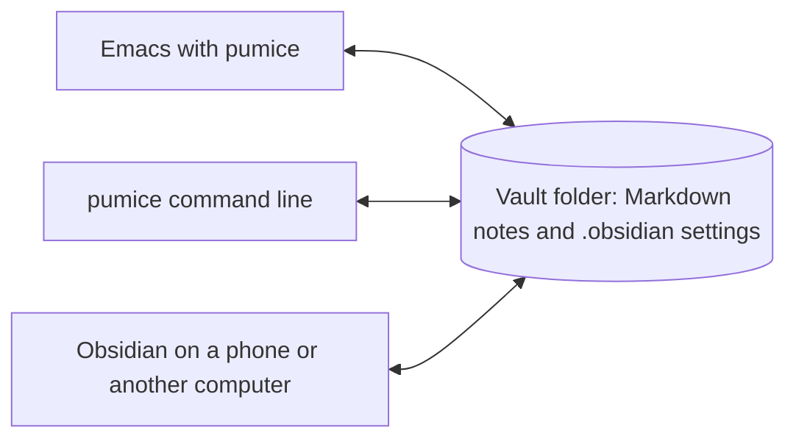

# pumice

[](https://github.com/kirahowe/pumice/actions/workflows/test.yml)
[](https://github.com/kirahowe/pumice/tags)
[](https://www.gnu.org/software/emacs/)
[](#install)
[](LICENSE)

Pumice is an Emacs package for working in an Obsidian vault without running
Obsidian. It's for people who keep their notes in a vault, already work in
Emacs, and would rather not run a second, heavier app to read them.


The recording uses the Atom One Dark theme and the optional packages
vertico, consult, corfu, and markdown-mode. Pumice doesn't need any of them.

Pumice works on your notes where they are, as plain Markdown with
`[[wikilinks]]`. It reads each vault's `.obsidian` settings to find out where
daily notes, templates, and new notes go, and it adds nothing of its own to
the vault. Obsidian on your phone or on another computer can keep working on
the same files.



The name comes from the rock: pumice is the same volcanic glass as obsidian,
with most of the weight taken out.

## Features

With pumice, you can:

- Jump to a note by name or alias. If the name matches no note, pumice
  starts a new note in the folder that the vault uses for new notes.
- Follow `[[Note]]`, `[[Note#Heading]]`, `[[Note|shown text]]`, `![[embeds]]`,
  and Markdown links to notes. Pumice colours each link by whether it
  resolves, and resolves links the same way Obsidian does, including when
  two notes share a name.
- Complete note names after `[[`, headings after `[[Note#`, and tags after
  `#`.
- Open a backlinks panel that follows the note you're in. The panel lists the
  lines that link to the note, the lines that mention it without linking,
  and the note's own outgoing links.
- Browse the vault in a folder tree in a side window.
- Keep daily notes in the vault's own folder, date format, and template.
  Commands open the note for yesterday, tomorrow, or any date, and the next
  or previous daily note that exists.
- Insert templates that use Obsidian's `{{title}}`, `{{date}}`, and `{{time}}`
  variables.
- Rename or move a note and rewrite every link to it, extract a region into
  a note of its own, and move a note to the vault's `.trash`.
- Use tags, including nested tags, from both the note text and the
  frontmatter.
- Search the text of every note.
- Ask the same questions from scripts and coding agents with the `pumice`
  command line, which doesn't need a running Emacs.

## Limitations

Pumice doesn't render embeds or Markdown inline, draw a graph, run Obsidian
plugins, or sync anything. Dataview queries, canvases, and `.base` files
appear as files that you can link to, not as Obsidian would draw them.
Pumice reads frontmatter as the flat properties that Obsidian writes, not as
arbitrary YAML.

## Install

Pumice requires Emacs 29.1 or later and has no other dependencies.

On Emacs 30 or later, add the following to your init file:

```elisp
(use-package pumice
  :vc (:url "https://github.com/kirahowe/pumice")
  :defer t
  :init
  (pumice-global-mode 1)
  (keymap-global-set "C-c n" 'pumice-command-map))
```

This installs the latest release. To follow the main branch instead, add
`:rev :newest` after the URL.

On Emacs 29, run `M-x package-vc-install`, enter
`https://github.com/kirahowe/pumice`, and then add the two lines from `:init`
to your init file.

If you don't use a package manager, clone the repository, add its directory
to `load-path`, and add `(require 'pumice)` before those two lines.

`pumice-global-mode` turns on `pumice-mode` in every Markdown file inside a
vault. `pumice-command-map` holds the commands. Pumice doesn't bind the map
to any key, so `C-c n` in the example is only a suggestion.

## Vaults

If Obsidian has run on this computer, pumice reads Obsidian's list of vaults,
and you don't need to configure anything. The vault that Obsidian last had
open becomes the default vault, which pumice uses when the current buffer
isn't in a vault.

The code that finds Obsidian's list of vaults has only been run on macOS. The
Linux and Windows locations come from Obsidian's documentation.
`pumice-vault-directories` works on every platform.

If Obsidian was never installed on this computer, list your vaults in
`pumice-vault-directories`:

```elisp
(setq pumice-vault-directories '("~/Notes" "~/Work notes"))
```

A folder in this list doesn't need a `.obsidian` directory, so a plain folder
of Markdown files also works. Such a folder gets the defaults: daily notes
named `YYYY-MM-DD` at the top of the folder, and no templates.

## Keys

The following keys work in a note:

| Key | What it does |
| --- | --- |
| `C-c C-o` | Follow the link at point. When point isn't on a note link, the key keeps its major-mode binding |
| `mouse-1` | Follow the link that you click |
| `M-,` | Go back to where you were before you followed a link or jumped to a note |

The following keys work after the prefix that you bound to
`pumice-command-map`:

| Key | What it does |
| --- | --- |
| `n` or `f` | Jump to a note, or start one |
| `s` or `/` | Search the text of every note |
| `#` | Pick a tag, then a note that has it |
| `h` | Open the home note (`pumice-home-note`, "Home" by default) |
| `z` | Open a random note |
| `v` | Switch to another vault |
| `d` `y` `t` | Open the daily note for today, yesterday, or tomorrow |
| `D` | Open the daily note for a date that you pick from the calendar |
| `<` `>` | Open the previous or next daily note that exists |
| `a` | Add a timestamped line to today's log without leaving the current buffer |
| `c` | Start a new note |
| `i` | Insert a link to a note. If a region is active, it becomes the link text |
| `T` | Insert a template |
| `x` | Extract the region into a new note and leave a link in its place |
| `r` | Rename or move the note, and rewrite the links to it |
| `X` | Move the note to the vault's trash |
| `RET` | Follow the link at point, or tick the checkbox on the current line |
| `[` `]` | Move to the previous or next link |
| `e` | Show the folder tree, or hide it when you're in the tree |
| `b` `B` | Show or hide the backlinks panel, or move to it |
| `O` | Open the note in Obsidian |

The following keys work in the backlinks panel:

| Key | What it does |
| --- | --- |
| `RET` | Go to the line |
| `o` | Show the line without leaving the panel |
| `l` | Turn an unlinked mention into a link |
| `n` `p` | Move to the next or previous item |
| `g` | Redraw the panel |
| `q` | Hide the panel |

The following keys work in the folder tree:

| Key | What it does |
| --- | --- |
| `RET` | Open a note, or fold or unfold a folder |
| `o` | Show a note without leaving the tree |
| `<right>` `<left>` | Step into or out of a folder |
| `E` `C` | Unfold or fold everything |
| `s` | Switch between sorting by name and sorting by date |
| `a` | Start a note in the folder |
| `r` | Rename or move the note |
| `g` | Reread the vault from disk |
| `q` | Hide the tree |

## Optional packages

Pumice uses the following packages when they're installed, and works
without them:

| Package | What it adds |
| --- | --- |
| [consult](https://github.com/minad/consult) | A live preview of each note while you choose one, and search as you type. Without consult, pumice uses plain `completing-read` and `rgrep` |
| [corfu](https://github.com/minad/corfu) or [company](https://company-mode.github.io) | A popup of note names as soon as you type `[[`. Without either, `M-x completion-at-point` completes note names |
| [markdown-mode](https://jblevins.org/projects/markdown-mode/) | A major mode for the notes. Its `gfm-mode` is the closer match to Obsidian's Markdown |
| [ripgrep](https://github.com/BurntSushi/ripgrep) | Unlinked mentions in the backlinks panel, and the search in consult |

Pumice doesn't change how notes look. If you want long lines to wrap, as
they do in Obsidian, add this hook:

```elisp
(add-hook 'pumice-mode-hook #'visual-line-mode)
```

## Keep Emacs's own files out of the vault

By default, Emacs writes backups (`Note.md~`), auto-save files (`#Note.md#`),
and lock files (`.#Note.md`) next to the file you're editing. In a vault,
those files get synced to your other devices. Pumice ignores them when it
builds its index, but it doesn't change where Emacs writes them. To store
them somewhere else, add the following:

```elisp
(let ((backups (locate-user-emacs-file "backups/"))
      (auto-saves (locate-user-emacs-file "auto-saves/")))
  (make-directory auto-saves t)
  (setq backup-directory-alist `(("." . ,backups))
        auto-save-file-name-transforms `((".*" ,auto-saves t))
        create-lockfiles nil))
```

If another program edits the vault while Emacs is open, for example Obsidian
on a phone through a sync service, turn on `(global-auto-revert-mode 1)` so
that open notes follow the changes to their files.

## Vim keys

The evil bindings are opt-in. If you use evil, add this line:

```elisp
(require 'pumice-evil)
```

The following keys work in a note, in normal state:

| Key | What it does |
| --- | --- |
| `RET` | Follow the link, or tick the checkbox, at point |
| `gf` | Follow a link |
| `gF` or `S-RET` | Follow the link in another window |
| `]l` `[l` | Move to the next or previous link |
| `]d` `[d` | Move to the next or previous daily note |

The backlinks panel and the folder tree open in motion state. In the tree,
`h` and `l` step out of and into folders, and `za`, `zM`, and `zR` fold.

Pumice doesn't bind a leader key. To put the command map on yours:

```elisp
(evil-define-key 'normal 'global (kbd "<leader>n") 'pumice-command-map)
```

## Spacemacs

The `contrib/spacemacs/pumice` directory is a Spacemacs layer. To use it,
copy or symlink it to `~/.emacs.d/private/pumice`, and add `pumice` to
`dotspacemacs-configuration-layers`. The layer installs the package, turns
on the global mode, loads the vim keys unless your editing style is `emacs`,
and puts the commands under `SPC a N`. To use a different key, set
`pumice-leader-key`:

```elisp
(pumice :variables pumice-leader-key "on")
```

## Command line

`bin/pumice` runs the same index in a batch Emacs, so it doesn't need a
running Emacs or a running Obsidian. Link the script into a directory on your
`PATH`:

```sh
ln -s /path/to/pumice/bin/pumice ~/.local/bin/pumice
```

If you installed pumice with `package-vc-install`, the script is in the
`pumice` directory under your `package-user-dir`.

For example:

```sh
pumice list --tag project --where status=active --show next_action
pumice backlinks "Weekly Review"
pumice tasks --folder Projects
pumice daily                        # path of today's note, created if missing
pumice log "Sent the invoice"       # a timestamped line under today's Log heading
pumice new "Title" --template "Meeting" --stdin < body.md
pumice set "Some note" status=done
pumice rename "Old name" "New name" # rewrites every link to the note
pumice unresolved                   # links that lead nowhere
```

`pumice help` lists every command. Commands that return a list print one
result per line, with paths relative to the vault root, or JSON if you pass
`--json`.

The command uses the vault named by `--vault` or `$PUMICE_VAULT`. If neither
is set, it uses the vault that contains the current directory, and then the
default vault. If `emacs` isn't on your `PATH`, set `PUMICE_EMACS` to your
Emacs executable.

You can symlink the script under another name. The command then uses that
name in its help and its messages.

## Performance

Pumice keeps its index in memory and rebuilds it from the files when Emacs
starts. After that, it rereads only the notes whose modification time has
changed.

On a synthetic vault of 5,000 notes with six links each (20 MB of Markdown),
a cold `pumice backlinks` run takes 0.9 seconds and peaks at 84 MB of memory.
A batch Emacs that does nothing takes 0.2 seconds and 54 MB. On a real vault
of 291 notes, a command takes 0.3 seconds. These figures come from an M4 Max
with Emacs 31.1 and byte-compiled files.

## Compatibility with Obsidian

Pumice shares a vault with Obsidian in these ways:

- Pumice never writes to `.obsidian` and never adds a cache or an index to
  the vault.
- New notes go where the vault's "Default location for new notes" setting
  says.
- Daily notes use the vault's folder, template, and date format. The date
  format supports text in square brackets and the Moment.js tokens `YYYY`,
  `YY`, `MMMM`, `MMM`, `MM`, `M`, `DD`, `D`, `dddd`, `ddd`, `HH`, `mm`, `ss`,
  `WW`, and `GGGG`.
- Links that pumice writes use the note's name when the name is unambiguous,
  and the note's path from the vault root when it isn't.
- Deleted notes go to the vault's `.trash` folder, which is one of Obsidian's
  own options for deleted files.

## Development

```sh
make test       # run the tests
make compile    # byte-compile, with warnings as errors
make            # both
make demo       # record the animation at the top of this file again
```

Each test builds a throwaway vault in the temp directory, so no test can
touch a real vault. To run the tests against the optional packages, pass the
directories where those packages and their dependencies are installed:

```sh
make test DEPS="/path/to/evil /path/to/goto-chg /path/to/consult"
```

The test for the vim keys runs only when evil is in that list.

[RELEASING.md](RELEASING.md) describes how to make a release, including how
to record the demo.

## Licence

GPL-3.0-or-later. See [LICENSE](LICENSE).
